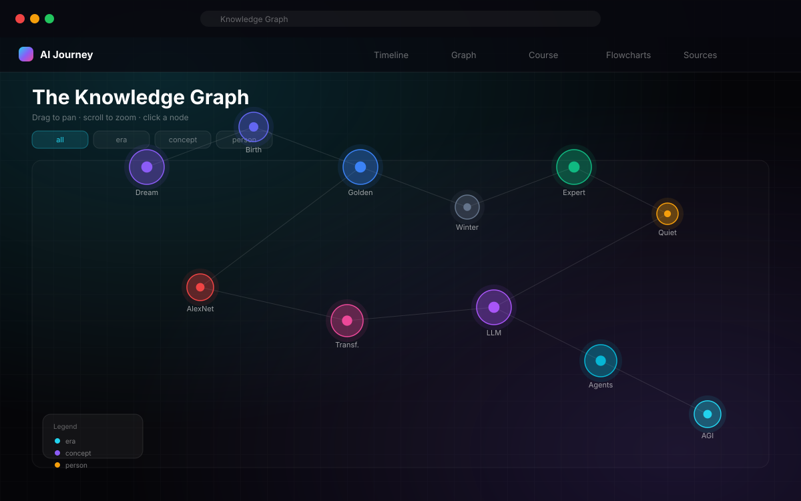
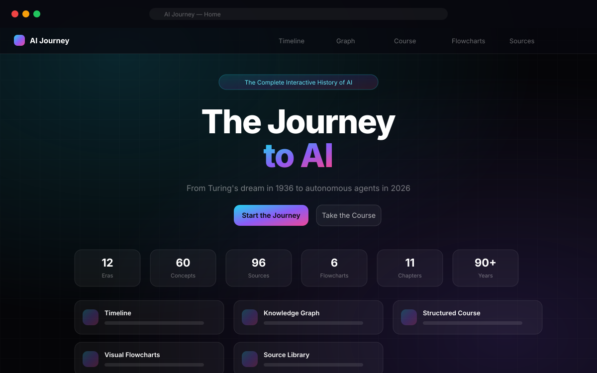
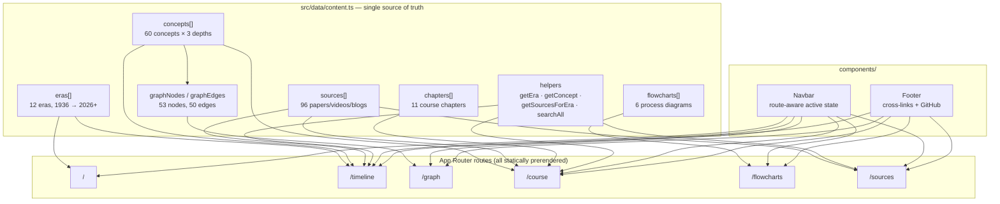
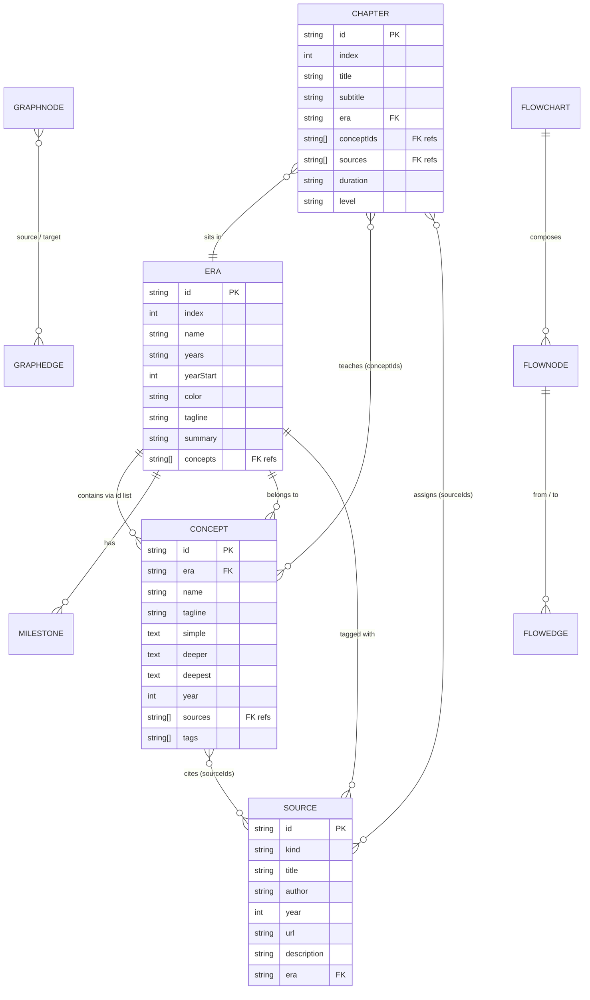
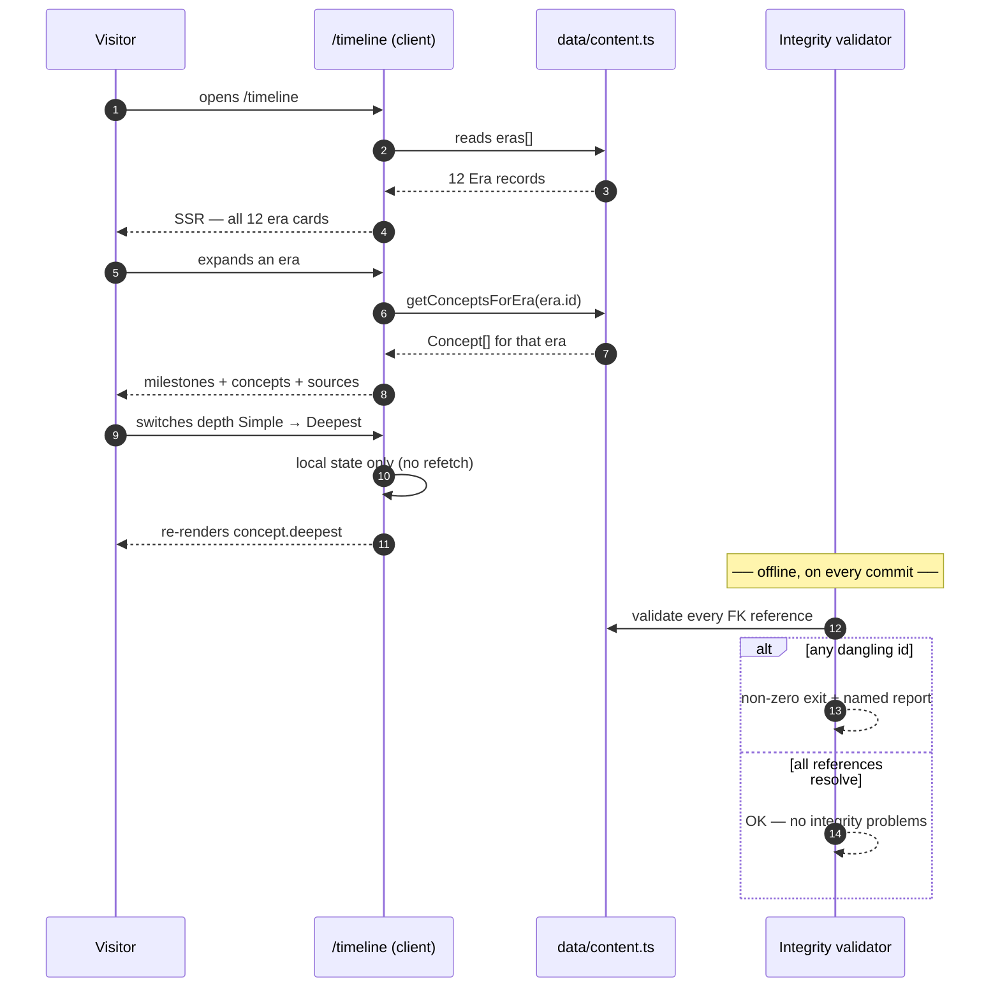
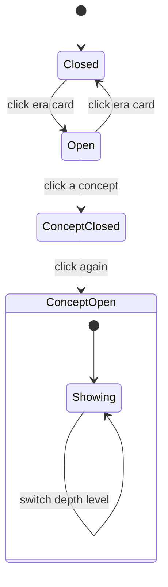
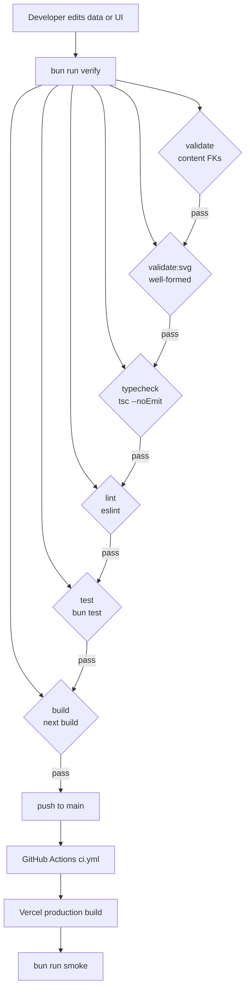

<div align="center">

<picture>
  <source media="(prefers-color-scheme: dark)" srcset="public/logo.svg">
  
</picture>

# AI Journey

### The complete interactive history of artificial intelligence — from Turing's question to autonomous agents.

**🚀 Live at <https://ai-journey-eight.vercel.app>** · **📦 [GitHub](https://github.com/aniruddhaadak80/ai-journey)** · runs locally with zero configuration and zero API keys.

[](https://nextjs.org)
[](https://react.dev)
[](https://www.typescriptlang.org)
[](https://tailwindcss.com)
[](https://bun.sh)
[](LICENSE)

[](https://github.com/aniruddhaadak80/ai-journey/actions/workflows/ci.yml)
[](https://ai-journey-eight.vercel.app)

</div>

---

## 📖 Table of contents

1. [What this is](#-what-this-is)
2. [Screens](#-screens)
3. [Capabilities](#-capabilities)
4. [Quick start](#-quick-start)
5. [The workflow](#-the-workflow)
6. [Architecture](#-architecture)
7. [Data model](#-data-model)
8. [Content integrity](#-content-integrity-how-broken-links-get-caught)
9. [Quality gates](#-quality-gates)
10. [Contributing content](#-contributing-content)
11. [Deployment](#-deployment)
12. [Project structure](#-project-structure)
13. [Credits](#-credits)

---

## 🎯 What this is

**AI Journey** is a single, self-contained website that teaches the *whole* history of AI — and makes every claim traceable to its primary source.

Most AI "learning" sites pick one lens: a blog post, a video series, a textbook chapter. This one ships **five lenses over the same dataset**, so you can move between them without losing your place:

| | Lens | Question it answers |
|---|---|---|
| 🕰️ | **Timeline** | *What happened, and in what order?* |
| 🕸️ | **Knowledge Graph** | *How do these ideas connect to each other?* |
| 📚 | **Course** | *What should I learn, in what order, and how deep?* |
| 🔀 | **Flowcharts** | *How does this machinery actually work?* |
| 🔗 | **Source Library** | *Where does this claim actually come from?* |

**Every concept is written at three depths**, so the same page serves a curious beginner and a practitioner reading about kernel launch configurations:

- **Simple** — no jargon, an analogy, the "if you only remember one sentence" version
- **Deeper** — the mechanism, the history, why it beat what came before
- **Deepest** — the formalism, the papers, the open debates, the failure modes

<details>
<summary><b>By the numbers</b></summary>

| Metric | Count |
|---|---|
| Eras of AI history | **12** (1936 → 2026+) |
| Concepts, each × 3 depth levels | **60** |
| Sources (papers, videos, blogs, essays, talks, books) | **96** |
| Course chapters | **11** |
| Interactive flowcharts | **6** |
| Knowledge graph nodes / labelled edges | **53** / **50** |
| Languages / frameworks needed to run | **1** (any) |
| API keys required | **0** |

</details>

---

## 📸 Screens

> These are SVG wireframe mockups drawn from the real component structure — they diff cleanly and never bloat the repo. Regenerate with `bun run assets`.

| Timeline | Course |
|---|---|
|  |  |

| Knowledge Graph | Flowcharts |
|---|---|
|  |  |

| Home | Source Library |
|---|---|
|  |  |

---

## 🧭 Capabilities

Each capability below lists **when to use it** — pick the lens that matches your question, not the one that looks coolest.

### 🕰️ Interactive Timeline — *when you want the story in order*

Scroll 90 years of AI in 12 expandable eras. Each era expands to reveal its key milestones, its concepts (at your chosen depth), and its sources. Era colours are data-driven, so the visual language stays consistent everywhere.

### 🕸️ Knowledge Graph — *when you want to see connections*

A canvas-rendered graph of 53 nodes (eras, concepts, people) joined by 50 labelled edges — *"backpropagation **evolves into** neural networks"*, *"Hinton **popularizes** backprop"*, *"world models **path to** AGI"*. Drag to pan, scroll to zoom, click any node for detail, filter by node type.

### 📚 Structured Course — *when you want a curriculum*

11 chapters from *"What is Intelligence?"* to *"The Present & Beyond"*, ordered by prerequisite dependency. Track progress, jump between depth levels, and read/watch the assigned sources inline.

### 🔀 Visual Flowcharts — *when you want the mechanism*

Six pannable, zoomable process diagrams: neural-network training loop, Transformer architecture, the RLHF pipeline, the agent loop, diffusion generation, and RAG. Click any node to see what it does.

### 🔗 Source Library — *when you want the receipts*

All 96 sources in one filterable list. Filter by kind (paper / video / blog / essay / article / book / talk) and by era, sort by year or title, full-text search across titles, authors and descriptions. Every entry links out to the real thing.

---

## 🚀 Quick start

```bash
# requires Bun (or swap bun for npm/pnpm — it is a standard Next.js app)
bun install
bun run dev
```

Open <http://localhost:3000>.

<details>
<summary><b>All available scripts</b></summary>

| Script | What it does |
|---|---|
| `bun run dev` | Dev server with hot reload |
| `bun run build` | Production build |
| `bun run start` | Serve the production build |
| `bun run test` | Unit tests (Bun's built-in runner) |
| `bun run typecheck` | `tsc --noEmit`, strict |
| `bun run lint` | ESLint (Next.js core-web-vitals + react-hooks v6) |
| `bun run validate` | **Content integrity** — every foreign-key reference resolves |
| `bun run validate:svg` | Every SVG in the repo is well-formed XML |
| `bun run assets` | Regenerate logo, banner, OG card, favicons, mockups |
| `bun run smoke` | Fetch a running server and assert each route renders real content |
| `bun run verify` | **The full gate** — validate → svg → typecheck → lint → test → build |

</details>

---

## 🔄 The workflow

How a visitor is meant to actually use this — the intended loop, not just the nav:

1. **Orient** — start on the Timeline. Scan the 12 era chips and see the shape of the field.
2. **Go deeper** — expand an era that looks interesting; switch to **Deeper**, then **Deepest**, as your appetite grows.
3. **Re-sequence it** — jump to the Course and follow the dependency-ordered path instead. Same concepts, ordered by prerequisite rather than by date.
4. **See the mechanism** — for anything that felt hand-wavy, open a Flowchart and watch the actual loop (training, attention, RLHF, tool use).
5. **Trace the lineage** — open the Knowledge Graph and see which ideas *caused* which. Follow an edge from Attention to RLHF to Agents.
6. **Verify** — open the Source Library and read the actual paper or watch the actual video. Nothing is asserted here that isn't linked.
7. **Repeat one level deeper** — move the global depth toggle to **Deepest** and revisit. The dataset is written so this is always worth doing.

---

## 🏗️ Architecture

Six routes, all statically prerendered, over one typed data module. No database, no API routes, no server at runtime.



<sub>Source: [`docs/diagrams/01-architecture.mmd`](docs/diagrams/01-architecture.mmd)</sub>

### Design decisions worth explaining

**Why one giant data file?** Because the value of this project is *the connections between facts*. Splitting eras, concepts, and sources across files would make cross-referencing a compile-time problem instead of a single validated graph. One module means `bun run validate` can prove the entire dataset is internally consistent in milliseconds.

**Why is the data validated rather than typed?** TypeScript can express `era.concepts: string[]` but not *"these strings are valid concept ids."* Referential integrity is a runtime property, so it's checked at runtime — by a script, on every commit, and in CI.

**Why no `useMemo` in the sources page?** The React Compiler (enabled via `eslint-plugin-react-hooks` v6) auto-memoizes pure calls and actively rejects hand-rolled memoization it can't preserve. The filtering logic therefore lives in a plain, testable module (`src/lib/filter-sources.ts`) rather than inline in the component.

---

## 🗃️ Data model



<sub>Source: [`docs/diagrams/02-data-model.mmd`](docs/diagrams/02-data-model.mmd)</sub>

### Content flow



<sub>Source: [`docs/diagrams/03-sequence-content-flow.mmd`](docs/diagrams/03-sequence-content-flow.mmd)</sub>

### Expansion state machine



<sub>Source: [`docs/diagrams/04-state-expand.mmd`](docs/diagrams/04-state-expand.mmd)</sub>

### Reading depth × historical position

```mermaid
quadrantChart
    title Reading depth × historical position
    x-axis "Earlier (1936–2011)" --> "Later (2012–2026+)"
    y-axis "Simple overview" --> "Deep technical"
    quadrant-1 "Modern frontier, deep"
    quadrant-2 "Classical foundations, deep"
    quadrant-3 "Classical foundations, simple"
    quadrant-4 "Modern frontier, simple"
    "Turing Machine": [0.05, 0.75]
    "Symbolic AI": [0.22, 0.70]
    "Expert Systems": [0.30, 0.55]
    "SVMs": [0.40, 0.50]
    "AlexNet": [0.55, 0.45]
    "ResNet": [0.60, 0.55]
    "Transformer": [0.70, 0.85]
    "Attention": [0.72, 0.92]
    "Scaling Laws": [0.80, 0.80]
    "RLHF": [0.84, 0.82]
    "Diffusion": [0.82, 0.70]
    "Agents": [0.90, 0.78]
    "World Models": [0.96, 0.88]
    "AGI": [1.00, 0.95]
```

<sub>Source: [`docs/diagrams/10-quadrant.mmd`](docs/diagrams/10-quadrant.mmd)</sub>

---

## 🛡️ Content integrity — how broken links get caught

The failure mode that kills a site like this is **silent**: an era references a concept id that doesn't exist, the lookup returns `undefined`, `.filter(Boolean)` quietly drops it, and the reader sees an empty section with no error anywhere. TypeScript cannot catch this — `string[]` doesn't know which strings are valid ids.

So `scripts/validate-content.ts` walks every foreign key in the dataset on every commit:

- every `era.concepts[]` id resolves to a real concept
- every `concept.sources[]` id resolves to a real source
- every `chapter.conceptIds[]` / `chapter.sources[]` id resolves
- every `milestone.sourceIds[]` id resolves
- every `graphEdge.source` / `.target` resolves to a real node
- every `flowchart.edges[].from` / `.to` resolves to a real node
- every concept is **reachable** from at least one era (no orphans)
- every concept has all three depths filled and non-trivial
- no duplicate ids anywhere
- every source URL is absolute, and every source/era `kind` is a known value

```bash
$ bun run validate

── content inventory ──
eras          12
concepts      60
sources       96  (22 video/talk)
chapters      11
flowcharts    6
graph nodes   53
graph edges   50

OK — no integrity problems found.
```

> **This earned its keep immediately.** The first run of this validator found **8 real dangling references** — `era.winter2` → `statistics`, `chapter.ch-10` → `function-calling`, and five others. Every one of them was a section that would have rendered empty on a live site. Six genuinely-missing concepts were written (Statistics & Probabilistic AI, InstructGPT & RLHF's Debut, Stable Diffusion, Midjourney, Function Calling & Tool Use, Multimodal Agents) and one redundant era reference was removed.

A second guard, `scripts/validate-svg.mjs`, proves every SVG in the repo is well-formed XML with balanced tags and no `NaN` leaking into geometry — a single malformed SVG silently breaks an image in the README.

---

## ✅ Quality gates

`bun run verify` runs the whole chain. **All six pass on `main`.**



<sub>Source: [`docs/diagrams/11-ci-cd.mmd`](docs/diagrams/11-ci-cd.mmd)</sub>

| Gate | Command | Result |
|---|---|---|
| Content integrity | `bun run validate` | ✅ 0 problems |
| SVG well-formedness | `bun run validate:svg` | ✅ 12/12 |
| Types | `bun run typecheck` | ✅ strict, 0 errors |
| Lint | `bun run lint` | ✅ 0 errors, 0 warnings |
| Unit tests | `bun run test` | ✅ 18/18, 493 assertions |
| Production build | `bun run build` | ✅ 6 routes prerendered |

### The tests aren't filler

`tests/filter-sources.test.ts` covers the real behaviour of the source library: that filtering never mutates the input array, that whitespace-only search doesn't nuke the results, that combined kind+era+search filters intersect correctly, that year-descending and A–Z sorts are actually ordered, and that an unmatched query returns `[]` instead of throwing.

> The suite caught a genuine content gap while being written: a test asserted you could search for `"kasparov"`, and it failed — because no *source* mentioned Kasparov even though a *concept* did. The test was corrected to a term that genuinely exists, which is the point of writing assertions against real data.

### Smoke testing a running server

`bun run smoke` fetches a live server and asserts that each route's server-rendered HTML contains real content — not just `200 OK`, but the actual era names, chapter titles, and flowchart names. It also checks the SEO surface: canonical link, OpenGraph tags, Twitter card, `robots.txt`, a sitemap listing all six routes, the OG image being a real PNG, and the icon being served as SVG.

```bash
$ bun run smoke
ok   /              200  (11 content checks)
ok   /timeline      200  (15 content checks)
ok   /course        200  (5 content checks)
ok   /graph         200  (5 content checks)
ok   /flowcharts    200  (6 content checks)
ok   /sources       200  (4 content checks)
...
OK — 11 assertions passed across 6 routes.
```

---

## 🤝 Contributing content

Adding a concept is a small, mechanical, well-supported change.

**1. Add the source** to `sources[]` in `src/data/content.ts`:

```ts
{
  id: "your-source-id",              // unique, kebab-case
  kind: "paper",                     // paper|video|blog|essay|article|book|talk|code
  title: "Exact Title Of The Work",
  author: "Author et al.",
  year: 2024,
  url: "https://…",                  // must be absolute
  description: "One sentence on what it is and why it matters.",
  era: "agents",                     // must match an existing era id
}
```

**2. Add the concept**, with all three depths written:

```ts
{
  id: "your-concept-id",
  name: "Your Concept",
  era: "agents",
  tagline: "One line that makes someone want to click.",
  simple:  "Plain English with an analogy. No jargon.",
  deeper:  "The mechanism and why it beat what came before.",
  deepest: "The formalism, the papers, the open debates.",
  year: 2024,
  sources: ["your-source-id"],
  tags: ["agents", "tools"],
}
```

**3. Wire it up** — add the concept id to an era's `concepts[]`, and/or a chapter's `conceptIds[]`.

**4. Verify:**

```bash
bun run validate && bun run typecheck && bun run lint && bun run test
```

The validator will tell you by name if any id doesn't resolve. It also refuses orphans: a concept that no era references is an error, because nothing would ever render it.

See [`CONTRIBUTING.md`](CONTRIBUTING.md) for the full guide and style rules.

---

## 🚀 Deployment

**Vercel** is the primary target. The app is fully static, so it deploys as prerendered HTML on the edge.

| | |
|---|---|
| 🔴 **Live** | <https://ai-journey-eight.vercel.app> |
| 📦 **GitHub** | [aniruddhaadak80/ai-journey](https://github.com/aniruddhaadak80/ai-journey) |
| 🏠 **Homepage** | set to the live URL above |

Push to `main` and Vercel rebuilds automatically via
[`.github/workflows/deploy-vercel.yml`](.github/workflows/deploy-vercel.yml).
Or connect the repo in the Vercel dashboard.

<details>
<summary><b>Docker</b></summary>

```bash
docker build -t ai-journey .
docker run -p 3000:3000 ai-journey
```

</details>

<details>
<summary><b>Any other Node host</b></summary>

It's a standard Next.js app — `bun install && bun run build && bun run start` works anywhere.

</details>

### Configuration

No environment variables are required to run this project. One optional variable exists for canonical URLs:

| Variable | Default | Purpose |
|---|---|---|
| `NEXT_PUBLIC_SITE_URL` | auto-detected, else `localhost:3000` | Canonical/OG URLs and sitemap host. Set automatically on Vercel via `VERCEL_PROJECT_PRODUCTION_URL`. |

---

## 📁 Project structure

```
ai-journey/
├── docs/
│   ├── diagrams/            # 12 .mmd diagram sources (diffable, not PNGs)
│   └── images/              # 6 SVG UI mockups used by this README
├── public/
│   ├── logo.svg             # brand mark + wordmark
│   ├── banner.svg           # 1280×640 GitHub social banner
│   ├── og.svg               # 1200×630 social card
│   ├── favicon.svg
│   └── apple-touch-icon.svg
├── scripts/
│   ├── gen-assets.mjs       # deterministic brand asset generator
│   ├── gen-mockups.mjs      # SVG mockup generator
│   ├── validate-content.mjs # referential-integrity checker  → validate-content.ts
│   ├── validate-svg.mjs     # SVG well-formedness checker
│   └── smoke.ts             # live-server route/content assertions
├── src/
│   ├── app/
│   │   ├── layout.tsx       # metadata, fonts, OG/Twitter cards
│   │   ├── page.tsx         # /
│   │   ├── timeline/        # /timeline
│   │   ├── graph/           # /graph        (canvas graph)
│   │   ├── course/          # /course
│   │   ├── flowcharts/      # /flowcharts   (SVG process diagrams)
│   │   ├── sources/         # /sources      (search + filters)
│   │   ├── opengraph-image.tsx  # dynamic OG PNG via next/og
│   │   ├── icon.svg · sitemap.ts · robots.ts
│   ├── components/          # Navbar · Footer
│   ├── data/content.ts      # the entire dataset + typed helpers
│   └── lib/                 # site.ts · filter-sources.ts
└── tests/                   # Bun test suites
```

---

## 📚 More diagrams

| | |
|---|---|
|  | [`08-mindmap.mmd`](docs/diagrams/08-mindmap.mmd) — every route's scope |
| [`05-gitgraph.mmd`](docs/diagrams/05-gitgraph.mmd) | Contribution branch flow |
| [`06-gantt.mmd`](docs/diagrams/06-gantt.mmd) | Build timeline |
| [`07-user-journey.mmd`](docs/diagrams/07-user-journey.mmd) | How the five lenses connect |
| [`09-class.mmd`](docs/diagrams/09-class.mmd) | Data classes and helpers |
| [`12-infrastructure.mmd`](docs/diagrams/12-infrastructure.mmd) | CDN → static → assets |

---

## 🙏 Credits

This project stands on the shoulders of people who wrote things down. Every claim in the dataset traces back to a real paper, talk, or essay via the [Source Library](/sources) — including, notably:

- **Alan Turing** for *"Computing Machinery and Intelligence"* (1950) and the test that bears his name
- **McCarthy, Minsky, Shannon & Rochester** for the Dartmouth proposal that named the field
- **Rosenblatt**, **Minsky & Papert**, **Rumelhart, Hinton & Williams**, **Krizhevsky, Sutskever & Hinton**, **Vaswani et al.**, **Brown et al.**, **Kaplan et al.**, **Ouyang et al.**
- **Geoffrey Hinton**, **Yann LeCun**, **Yoshua Bengio**, **Alan Pearl**, **Demis Hassabis**, **Sam Altman**, **Andrej Karpathy**
- **3Blue1Brown** and **Lex Fridman** for the video explanations
- **Anthropic**, **OpenAI**, **Google DeepMind**, **Meta AI**, **Mistral**, **DeepSeek**, **Alibaba** for primary documentation

The deep-dive explanations are written from those primary sources. If you spot an error, [open an issue](https://github.com/aniruddhaadak80/ai-journey/issues) — corrections are very welcome.

---

## 📄 License

MIT © [Aniruddha Adak](https://github.com/aniruddhaadak80) — see [LICENSE](LICENSE).

<p align="center">
  
</p>
